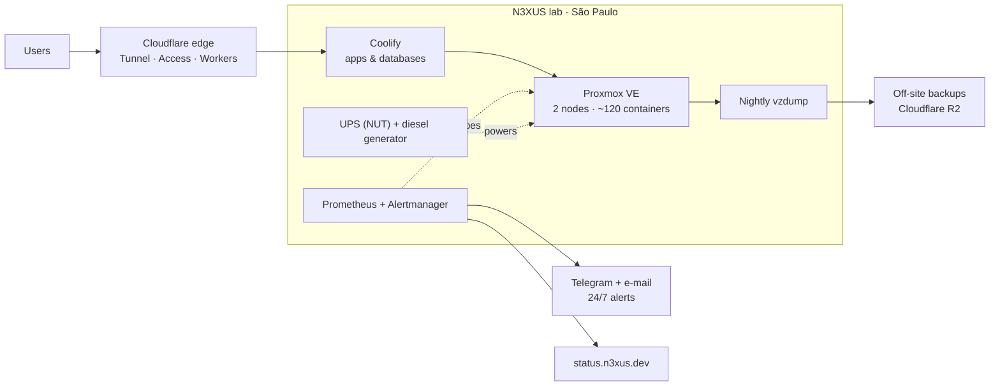

# N3XUS

### Software built, secured and kept online — on infrastructure we run ourselves

Engineering studio from São Paulo, Brazil. We design, ship and operate products end to end:
self-hosted platform, Zero Trust edge, 24/7 alerting and AI where it actually helps.

---

## Table of Contents

- [Overview](#overview)
- [What we do](#what-we-do)
- [In production](#in-production)
- [Platform](#platform)
- [Open source](#open-source)
- [How we work](#how-we-work)
- [Current status](#current-status)

---

## Overview

**N3XUS** is a small engineering studio founded by Thiago "Samurai" Rangel. We don't hand over a repository and
walk away: every product we build runs on a platform we operate, with monitoring, backups and an on-call loop
from day one.

It is built for:

- founders and small teams who need a product **online and staying online**, not just a demo;
- organizations handling sensitive data that need **security and LGPD** designed in, not patched on;
- operations that want **AI with a human in the loop**, where uncertain output stays reviewable.

---

## What we do

| | What it means | Examples |
|---|---|---|
| **Build** | Web products and internal tools, from first screen to production | Next.js, Astro, React, Node.js, Python, Supabase |
| **Secure** | Threat modeling, hardening, authorized assessments, privacy by design | OWASP ASVS/Top 10, CVSS, Cloudflare Access, LGPD |
| **Run** | Hosting, deploys, backups and 24/7 alerting on our own platform | Proxmox VE, Coolify, Prometheus, Alertmanager |
| **AI** | Agents, structured extraction and voice pipelines with review gates | LLM integrations, Whisper, local embeddings |

---

## In production

| Product | What it is | Link |
|---|---|---|
| **CyberJust** | Cybersecurity media & education about real Brazilian cybercrime cases, with an AI-voiced podcast | [cyberjus.org](https://cyberjus.org) |
| **Ops Log AI** | Aviation operations cockpit: flight logs, fuel receipts and maintenance images → human-reviewed records | [opslog.n3xus.dev](https://opslog.n3xus.dev) |
| **n3xs-db** | Electronic pilot logbook with digital signature (ANAC Res. 458/2017), multi-tenant, LGPD by design | private |
| **Status page** | Public, real-time status of every service we run | [status.n3xus.dev](https://status.n3xus.dev) |
| **n3xus.dev** | Company site in Portuguese, English, Hebrew and Arabic (RTL) | [n3xus.dev](https://n3xus.dev) |

---

## Platform

| Layer | How it works |
|---|---|
| **Edge** | ~50 public sites behind Cloudflare Tunnel; admin panels behind Cloudflare Access. Nothing is exposed directly. |
| **Deploy** | Coolify on our own VMs, one deploy key per app, deploys from git push |
| **Data** | Self-hosted Supabase / PostgreSQL / MariaDB, nightly backups and off-site copies |
| **Monitoring** | 71 Prometheus alert rules tuned on real incidents, dead man's switch, public status page |
| **Power** | UPS with automatic shutdown via NUT, plus a diesel generator for long outages |

The monitoring stack is open source: **[n3xus-lab-observability](https://github.com/Samurai33/n3xus-lab-observability)**.

---

## Open source

| Repository | What you can verify |
|---|---|
| **[n3xus-lab-observability](https://github.com/Samurai33/n3xus-lab-observability)** | The lab's monitoring stack, sanitized: Prometheus/Alertmanager rules, read-only Proxmox & MikroTik, NUT/vzdump/Docker collectors |
| **[CyberJust](https://github.com/Samurai33/CyberJust)** | Next.js product with unit + E2E tests, security policy and 185+ issues & PRs with conventional commits |

Forks in this organization are working copies of upstream projects we evaluate or adapt. Credit belongs to
their original authors.

---

## How we work

- **Security before spectacle** — authentication, isolation and sensitive-data handling are architecture, not a checklist at the end.
- **AI assists; humans stay accountable** — uncertain output is explicit, reviewable and correctable.
- **Evidence over claims** — tests, local CI in Docker, docs and known limitations tell the story.
- **Production is a gate** — a working demo is not a production-ready system.
- **Least privilege everywhere** — read-only tokens, per-app keys, private networks by default.

---

## Current status

| | |
|---|---|
| **Based in** | São Paulo, Brazil · remote worldwide |
| **Platform** | 2 Proxmox VE nodes, ~120 containers, ~50 public sites, 24/7 alerting |
| **Open to** | New products, platform migrations, security assessments (authorized scope only) |

---

**Need something built, secured or kept online?** → [contato@n3xus.dev](mailto:contato@n3xus.dev) · [n3xus.dev](https://n3xus.dev)

© N3XUS · São Paulo, Brazil

